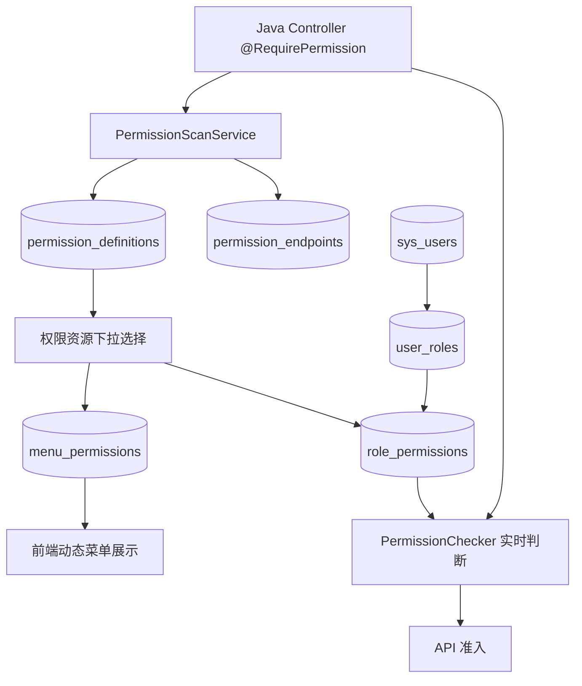

# 架构设计与工程约束

## 一、按技术职责分包

```text
backend/src/main/java/com/example/permissionhub
├── PermissionHubApplication.java
├── controller/    # HTTP 路由、请求校验、认证上下文与响应适配
├── service/       # 业务规则、权限扫描、用例编排与事务
├── repository/    # Flex 查询、DTO 映射与演示种子数据持久化
├── mapper/        # 薄 BaseMapper 接口，由 MapperScan 注册
├── entity/        # @Table / @Id 显式映射数据表
├── dto/           # 每个请求/响应 DTO 与扫描 record 单独成文件
├── config/        # SecurityConfig 与经校验的 PermissionProperties
├── security/      # RequirePermission 注解与 PermissionChecker
├── constant/      # PermissionCodes、SecurityConstants
├── enums/         # MenuType、PermissionKind、PermissionStatus
├── exception/     # BusinessException、GlobalExceptionHandler
└── bootstrap/     # 演示初始化编排（生产移除）
```

本项目按已确认的工程约定统一采用技术层包；每层直接放置职责明确的类，菜单、角色、用户、审计等业务不再单独建立包。保留根包入口，由 Spring Boot 默认组件扫描覆盖各层。

- `controller` 只适配 HTTP 与认证上下文，调用对应 Service，不直接访问 Repository 或编写 SQL。
- `service` 按具体用例命名，负责规则校验、权限同步、审计调用和事务。权限同步与同步审计在同一服务事务中完成；内存设备样例状态由 `DeviceService` 持有。
- `repository` 通过 MyBatis-Flex BaseMapper 与使用 APT 表定义的 QueryWrapper 访问数据库，查询条件由框架绑定参数；Controller/Service 不持有 Mapper。数据库实体在仓储边界映射为公开 DTO，登录凭据实体仅在内部鉴权时使用。菜单父级清空使用 UpdateEntity 显式写入 null；自增主键由 Mapper 回填，关联表采用复合主键映射。
- `dto` 内每个类型独立成文件，Controller、Service、Repository 内不嵌套声明传输 record，原有 Models 聚合类已拆除。保留现有请求/响应字段与校验规则，JSON 契约及路由保持兼容。`PermissionView` 使用 `@Getter`、`@Builder`，仅端点装配字段开放 Setter；适合不可变值的模型使用 record。
- `config` 使用经校验的 `PermissionProperties` 绑定 `app.permission`，默认值集中在 `application.yml`。构造器注入使用 `@RequiredArgsConstructor` 与 final 依赖。

`PermissionCodes` 是 Java 权限码唯一声明位置；`PermissionKind` / `PermissionStatus` / `MenuType` 表达有限状态，中文业务元数据在 `@RequirePermission` 中维护。本次调整不改变数据库表、演示数据、API 路径或前端目录。

持久层使用 MyBatis-Flex **1.11.8** 的 Spring Boot 3 starter，并显式配置 `mybatis-flex-processor`。`backend/mybatis-flex.config` 统一 APT 设置，表定义生成到 `backend/target/generated-sources/annotations`，不手工维护生成源码。`spring-boot-starter-jdbc` 提供 HikariCP/数据源与建表基础设施；应用持久化代码使用 Flex Mapper，不使用 JdbcTemplate。

Spring `@Transactional` / `TransactionTemplate` 交由 Flex 事务管理器处理。测试数据准备与数据库断言统一使用 Flex `Db`，保证与 Mapper 使用同一事务并在用例结束后回滚。权限同步只在发现权限时更新最后扫描时间，标记废弃不覆盖该时间。

版本与接入方式参考 [官方 Maven 依赖](https://mybatis-flex.com/zh/intro/maven.html)、[APT 设置](https://mybatis-flex.com/zh/others/apt.html)和[事务管理](https://mybatis-flex.com/zh/core/tx.html)。

## 二、权限模型



**区分：** 菜单映射负责展示与导航；角色权限负责实际授权；`@RequirePermission` 保护 Controller 方法。不可根据菜单是否隐藏判断 API 访问权。目录没有权限码；页面允许关联多个权限码（满足任意一个即可显示），但每个 API 仍按独立注解执行授权。

**同码复用：** 多个 Endpoint 可绑定同一权限码，但 `name/module/kind/description` 必须严格相同，元数据冲突立即失败。生产中可进一步引入 `PermissionCatalog` 注解生成器以消除同码说明重复，但不建议同时维护两个彼此独立的手工权限定义清单。

## 三、权限生命周期

- 启动：扫描 `RequestMappingHandlerMapping` 的真实 URL + HTTP Method，事务内 Upsert 定义，重建端点映射；**不**标记缺失权限过期（规避滚动升级时不同实例差异）。
- 后台“重新扫描同步”：对当前服务快照进行调和，将消失的代码权限标记为 `DEPRECATED`。保留菜单、角色引用、权限记录和旧端点，绝不硬删。
- 发现权限码重复但语义冲突、非法权限码或未知来源占用同码时，抛出错误并回滚。
- **限制：** 此 Demo 为单后端实例 + 本地 H2；跨服务注册、滚动发布、多实例同步不能直接复用“手工同步标废弃”逻辑，需 `service+version+deploymentId` 快照、审批和延迟淘汰或改用构建期 manifest。

## 四、授权与安全

- 新注解通过 `@PreAuthorize("@permissionChecker.hasPermission('{code}')")`，实时从数据库关联 `sys_users → user_roles → role_permissions → permission_definitions`；用户停用或角色授权修改可以实时影响新注解。
- 超级管理员由数据库 `super_admin` 明确控制；它是全局操作能力，禁止管理员通过普通 UI 将其他用户升级为超级管理员。
- 旧 `@PreAuthorize("hasAnyAuthority('xxx','*:*:*')")` 暂时继续运行；旧 authorities 在登录时建立快照，**更改权限后需重新登录才能对旧注解生效**。`*:*:*` 是准确匹配的特殊 authority，不是 Spring 原生通配符。
- Session Cookie `HttpOnly + SameSite=Lax`，Spring Security CSRF Cookie Token（前端需提供 `X-XSRF-TOKEN`）；BCrypt 密码哈希；拒绝将 token、密码原文写入 audit detail。
- Demo 不含验证码、IP 限速、账号锁定、MFA、登录审计、统一身份认证、会话踢下线等生产级能力。

## 五、下一阶段演进

1. 构建时生成 `permission-manifest.json` 并随 CI/CD 统一发布，减少运行时权限中心依赖。
2. 注册中心持久化使用 `application_code + service_name + release_version` 组合快照，并采用异步幂等上传和删除审批。
3. 引入缓存+事件驱动失效通知优化高并发 PermissionChecker 当前逐次 DB 查询的性能，增加多租户/数据行级 ABAC 条件。
4. 建立菜单配置与代码权限映射的版本审核、灰度发布与告警。
5. 对授权操作提供双人复核、审批流和完整审计溯源。
